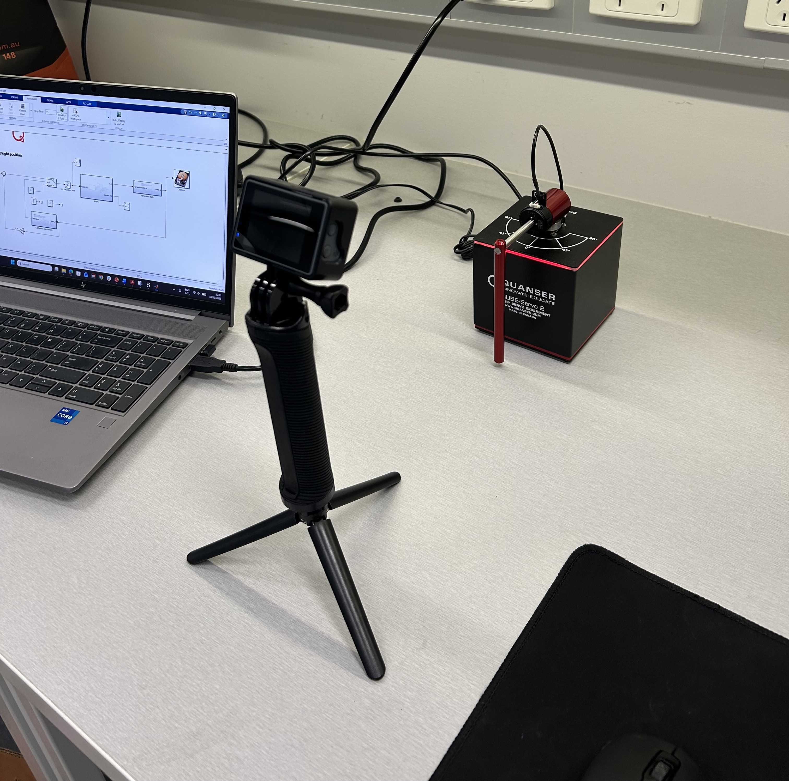

  
  

# Experimental Validation of Control Methods

Welcome to the supplementary website accompanying my research internship thesis: **Data-driven Optimal Control on Quanser Qube**.

**Author:** Jort Stammen  
**Supervisors:** Sasha Pogromskiy (TU/e), Dragan Nesic (UoM), Mathieu Granzotto (UoM)  
**Institutions:** Eindhoven University of Technology (TU/e) & The University of Melbourne (UoM)

---

## About This Website

This website presents synchronized animations, video recordings, and key metrics from the experimental evaluation of model-based and data-driven control methods on physical hardware. Because closed-loop dynamics—such as disturbance recovery, limit cycles, and servo drift—cannot be fully captured on paper, this platform provides a visual complement to the thesis.

  
  
<i>Figure: The Quanser QUBE-Servo 2 experimental setup used for all validations.</i>

## The Experiments

The experiments are organized following the structure of the thesis and demonstrate discounted Linear Quadratic Regulation (LQR) on the **Quanser QUBE-Servo 2** in both its inertia-disc and rotary inverted-pendulum configurations.

### Model-Based Methods (Chapter 2 & 5)
Experimental validation of model-based stabilizing near-optimal controllers synthesised from the linearised upright pendulum model.

 * **Baseline Controllers:** Comparison of convex LMI designs (\(\hat{K}_\gamma\) and \(\bar{K}_\gamma\)) and stabilizing policy iteration (sPI) at \(\gamma = 0.5\), \(\alpha = 0.98\).
 * **\(\alpha\)- and \(\gamma\)-Sweeps:** Manual-push robustness and steady-state tests mapping the usable operating window under servo drift and \(\pm 10\text{ V}\) actuator saturation.

[**Explore Model-Based Experiments**](experiments/modelbased/index.md)

### Data-Driven Methods (Chapter 3 & 5)
Experimental validation of direct (noise-free and noisy LMI) and indirect (least-squares and instrumental-variable) controllers synthesised from measured input–state data.

 * **Inertia Disc:** Open-loop excitation and closed-loop reference tracking (\(5^\circ\) and \(50^\circ\) square waves, chirp).
 * **Pendulum Balance Control:** Closed-loop probing and programmed-pulse disturbance rejection, comparing direct, indirect, and relaxed noisy LMI designs.

[**Explore Data-Driven Experiments**](experiments/datadriven/index.md)

---

## How to Use This Website

Select an experiment from the navigation menu to find:

 1. **Setup & Parameters:** The controller parameters (e.g., \(\gamma\), \(\alpha\), \(T_s\)) and synthesised gains.
 2. **Synchronized Videos:** Side-by-side MATLAB logged responses and physical hardware recordings.
 3. **Observations:** Key experimental takeaways, including recovery, saturation, and steady-state behaviour.

## Relation to the Thesis
All experiments correspond directly to **Chapter 5 (Experimental Results)** of the thesis. The theoretical foundations are presented in **Chapter 2** (Model-Based) and **Chapter 3** (Data-Driven), while the hardware platform and real-time implementation are detailed in **Chapter 4**.