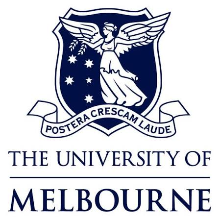

  
  

# Experimental Validation of Control Methods

Welcome to the supplementary website accompanying my research internship thesis: **Data-driven Optimal Control on Quanser Qube**.

**Author:** Jort Stammen  
**Supervisors:** Sasha Pogromskiy (TU/e), Dragan Nesic (UoM), Mathieu Granzotto (UoM)  
**Institutions:** Eindhoven University of Technology (TU/e) & The University of Melbourne 

---

## About This Website

This website presents videos and additional results from the experimental evaluation of data-driven and model-based control methods on physical hardware. Because the dynamic behavior of the closed-loop systems—such as disturbance rejection, recovery, and servo drift—cannot be fully captured on paper, this platform provides a visual complement to the results presented in the thesis.

  
  
<i>Figure: The Quanser QUBE-Servo 2 experimental setup used for all validations.</i>

## The Experiments

The videos are categorized according to the structure of the thesis. Each section demonstrates the real-world application of Discounted Linear Quadratic Regulation (LQR) on the **Quanser QUBE-Servo 2** rotary inverted pendulum.

### Data-Driven Methods (Chapter 3 & 5)
Experiments investigating direct and indirect data-driven controller designs from measured input-state data, without prior system identification. 

*   **Inertia Disc:** Servo angle tracking and reference following.
*   **Pendulum Balance Control:** Stabilizing the pendulum using probing data, demonstrating robustness against programmed pulse disturbances.
*   **Noisy Data Designs:** Demonstrating the conservatism and robustness of relaxed LMI designs under measurement noise.

[**Explore Data-Driven Experiments**](experiments/datadriven/index.md)

### Model-Based Methods (Chapter 2 & 5)
Experiments investigating model-based controller design and its experimental performance using known system dynamics.

*   **Guaranteed Cost & Gain Error:** Demonstrating convex LMI-based designs (${\hat{K}_\gamma}$ and ${\bar{K}_\gamma}$).
*   **Stabilizing Policy Iteration (sPI):** Iterative approaches to finding stabilizing near-optimal gains.
*   **Robustness & Sweeps:** Multi-push disturbance tests and sweeps over the decay rate ($\alpha$) and discount factor ($\gamma$) to observe hardware limitations like servo drift and voltage saturation.

[**Explore Model-Based Experiments**](experiments/modelbased/index.md)

---

## How to Use This Website

Select an experiment from the navigation menu to find:
1. **Objective:** What the specific experiment aims to prove.
2. **Setup:** The controller parameters used (e.g., $\gamma$, $\alpha$, $T_s$).
3. **Videos:** High-framerate recordings of the physical tests.
4. **Observations:** Key takeaways, such as settling time, peak deviations, and steady-state behavior.

## Relation to the Thesis
All experiments shown here correspond directly to **Chapter 5 (Experimental Results)** of the thesis. The theoretical groundwork for the controllers can be found in **Chapter 2** (Model-based) and **Chapter 3** (Data-driven), while the hardware specifics are detailed in **Chapter 4**.